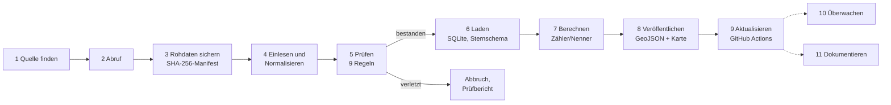
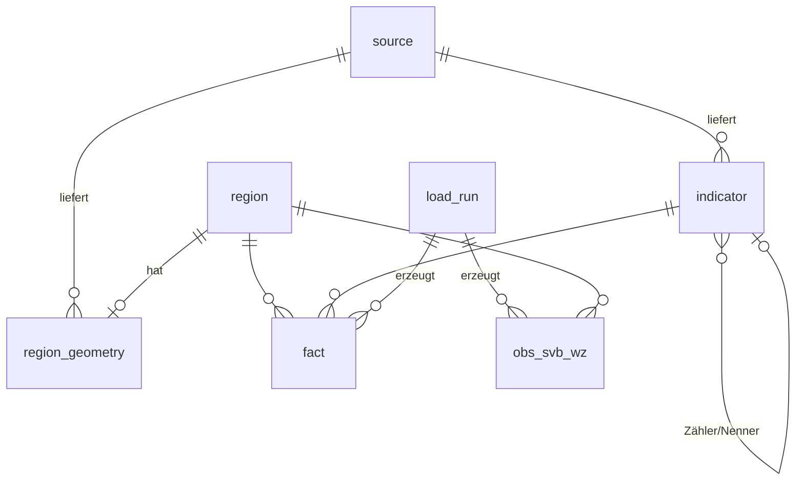

# Kreisatlas-Pipeline: Industrieanteil der Beschäftigung je Kreis

Ein kleiner, vollständiger Weg von einer offenen Statistiktabelle zu einer geprüften Kreiskarte, mit Datenmodell, automatisierter Pipeline und Tests. Gebaut als Arbeitsprobe in rund vier Stunden.

**Ergebnis:** Der Industrieanteil reicht in Brandenburg von **1,8 %** (Potsdam) bis **27,3 %** (Oder-Spree), im Land sind es **13,0 %** (Stichtag 30.06.2025).

- **Karte online: [ilya-data.github.io/kreisatlas_pipeline](https://ilya-data.github.io/kreisatlas_pipeline/)** (erzeugt aus [`out/karte.html`](out/karte.html) durch den Workflow)
- Daten: [`out/kreise_industrieanteil.geojson`](out/kreise_industrieanteil.geojson) (GitHub zeigt die Datei direkt als Karte an), [`out/atlas.sqlite`](out/atlas.sqlite)
- Prüfbericht: [`out/pruefbericht.json`](out/pruefbericht.json)

## Schnellstart

```bash
export PYTHONPATH=src
python -m atlas.pipeline --force      # ohne --force: nur bei geänderten Rohdaten
python -m pytest -q                   # einzige Abhängigkeit: pytest
```

Die Pipeline nutzt nur die Python-Standardbibliothek (sqlite3, csv, struct, json). Das GeoPackage wird ohne GDAL oder geopandas gelesen, die Koordinaten werden selbst von UTM nach WGS84 umgerechnet. Das hält die Automatisierung schlank und reproduzierbar. Für den Ausbau (siehe unten) ist das eine bewusste Prototyp-Entscheidung, keine Empfehlung.

## Ablauf



Gestrichelt: im Prototyp nur beschrieben (siehe „Nächste Schritte“).

| Schritt | Im Prototyp | Modul |
|---|---|---|
| 2–3 Abruf, Rohdaten sichern | Rohdateien im Repository, Prüfung gegen [`data/raw/MANIFEST.json`](data/raw/MANIFEST.json) | `raw.py` |
| 4 Einlesen | GENESIS-CSV in eine lange Tabelle (1.596 Werte), GeoPackage-Binary dekodieren | `parse_regio.py`, `geo.py` |
| 5 Prüfen | 9 Regeln, Fehler stoppen das Laden | `validate.py` |
| 6 Laden | Neuaufbau in einer Transaktion, alte Datenbank bleibt bei Fehlern erhalten | `db.py` |
| 7 Berechnen | Anteil = Zähler / Nenner, beide gespeichert | `indicators.py` |
| 8 Veröffentlichen | GeoJSON (WGS84) und HTML-Karte aus der Datenbank | `publish.py` |
| 9 Aktualisieren | wöchentlicher Lauf, rechnet nur bei geänderten Prüfsummen neu | `pipeline.py`, `.github/workflows/pipeline.yml` |

## Datenmodell

Ein Sternschema: Jeder neue Indikator ist eine Zeile in `indicator` und neue Zeilen in `fact`, ohne Schemaänderung.



| Tabelle | Inhalt |
|---|---|
| `region` | Regionalschlüssel, Name, Ebene, übergeordnete Region, Gebietsstand, gültig von/bis, Fläche |
| `region_geometry` | Geometrie getrennt von den Stammdaten (GeoJSON, EPSG:4326) |
| `indicator` | Name, Einheit, Definition, Quelle; bei Anteilen Verweis auf Zähler und Nenner |
| `source` | URL, Lizenz, Quellenvermerk, Aktualisierungsrhythmus |
| `fact` | Region × Indikator × Zeitraum → Wert, Qualitätsmarke (`ok`, `geheim`, `gerundet`, `geschaetzt`), Lauf |
| `obs_svb_wz` | normalisierte Rohtabelle (Staging) mit dem Originalzeichen je Zelle |
| `load_run` | Zeitpunkt, Prüfsummen aller Rohdateien, Prüfbericht → jeder Wert ist zur Rohdatei rückverfolgbar |

Beispielabfrage: `SELECT * FROM v_industrieanteil ORDER BY anteil_prozent DESC;`

## Quellen und Lizenzen

| Quelle | Inhalt | Lizenz |
|---|---|---|
| [Regionalstatistik 13111-07-05-4](https://www.regionalstatistik.de/genesis/online?operation=table&code=13111-07-05-4) | SV-Beschäftigte am Arbeitsort nach Wirtschaftszweig, Geschlecht, Nationalität; Kreise, Stichtag 30.06.2025 | dl-de/by-2-0, © Statistische Ämter des Bundes und der Länder, Deutschland, 2026 |
| [BKG VG2500](https://gdz.bkg.bund.de/index.php/default/digitale-geodaten/verwaltungsgebiete/verwaltungsgebiete-1-2-500-000-stand-31-12-vg2500-12-31.html) | Kreisgrenzen 1:2.500.000, Stand 31.12.2025, UTM32 | dl-de/by-2-0, © GeoBasis-DE / BKG (2025), Daten verändert |

Werte und Karte sind eigene Berechnungen. Die Quellenvermerke stehen auch in Karte, GeoJSON und Datenbank (`source`).

## Was der Parser abfängt

- Kodierung cp1252, Kopfblock, Metadaten-Fußzeile, Spaltenkopf über vier Zeilen (Nationalität × Geschlecht).
- Ein Label in Anführungszeichen mit Semikolon („Öff. Verwaltung, Verteidig.; Sozialvers., …“).
- Drei Zeilen ohne Buchstabencode → `M-N`, `O-Q`, `R-U` per fester Zuordnung. Ein unbekanntes Label bricht ab, statt still verloren zu gehen.
- Symbole: `.` → Wert leer, Qualität `geheim` (45 Zellen); `-` → 0 (2 Zellen). Andere Zeichen brechen ab.
- Überlappende Wirtschaftszweige (B-F ⊃ B-E ⊃ C). Eine einfache Summe über alle Zeilen ergäbe das 2,1-Fache von „Insgesamt“. Deshalb arbeiten Berechnungen und Prüfungen mit einer festen, disjunkten Zerlegung.

**Annahme:** Die Datei enthält keine Zeichenerklärung. Die Bedeutung von `.` und `-` folgt der Standard-Zeichenerklärung der Regionaldatenbank und ist dort noch zu bestätigen.

## Prüfregeln und Befund

| Regel | Stufe | Ergebnis |
|---|---|---|
| Vollständigkeit (jede Region × Wirtschaftszweig × 6 Spalten) | Fehler | 1.596 geprüft, 0 auffällig |
| Abgleich Statistik ↔ Geometrie (Regionalschlüssel) | Fehler | 18, 0 |
| männlich + weiblich = insgesamt | Fehler | 526, 0 |
| ausländisch ≤ insgesamt | Fehler | 753, 0 |
| Hierarchie: B-F = B-E + F; G-U = Summe G-I…R-U; A + B-F + G-U ≤ Insgesamt; C ≤ B-E | Fehler | 456, 0 |
| Summe der 18 Kreise = Land | Fehler | 84, 0 |
| Wertebereich der Indikatoren | Fehler | 57, 0 |
| Anteil geheimer Werte ≤ 10 % | Warnung | 2,8 % |
| Beschäftigte ohne Wirtschaftszweig | Warnung | 3 Fälle |

Bei geheimen Werten prüfen die Regeln nur die abgeschwächte Ungleichung (bekannte Teile ≤ Summe). Unterdrückte Werte werden nie über Differenzen zurückgerechnet.

Der Befund zur letzten Zeile: In Potsdam und Spree-Neiße liegt „Insgesamt“ um je eine Person über der Summe der Wirtschaftszweige, im Land um zwei. Das sind Beschäftigte ohne Zuordnung zu einem Wirtschaftszweig. Eine erste, strengere Regel (Summe = Insgesamt) hat das aufgedeckt. Sie wurde daraufhin bewusst zu „≤“ plus Warnung geändert.

## Indikator und Grenzen

**Industrieanteil** = SV-Beschäftigte im Verarbeitenden Gewerbe (WZ 2008, Abschnitt C) / alle SV-Beschäftigten am Arbeitsort.

- Näherung für „Industrie“: Bergbau und Energie (B, D, E) sowie Bau (F) fehlen. Branchen wie Auto, Chemie oder Stahl sind auf Kreisebene in dieser Tabelle nicht getrennt.
- Arbeitsortprinzip: Gezählt wird der Betriebsstandort. Pendlerräume wie das Berliner Umland sind dadurch anders strukturiert als die Wohnbevölkerung.
- Nur sozialversicherungspflichtig Beschäftigte; Beamte, Selbständige und Minijobs fehlen.
- Berlin ist nicht Teil der Tabelle und in der Karte als Lücke gekennzeichnet.
- Klassen: fünf feste, runde Grenzen (5/10/15/20 %) statt Quantilen. So bleiben die Karten über Jahre und Länder hinweg vergleichbar.

## Herausforderungen auf dem Weg zur produktiven Pipeline

- **Gebietsstände:** Kreisreformen ändern Schlüssel und Grenzen. `region` hat dafür gültig von/bis und den Gebietsstand. Für Zeitreihen braucht es Umschlüsselungstabellen.
- **Stichtage:** Quellen sind unterschiedlich aktuell (hier Daten 30.06.2025, Grenzen 31.12.2025). Jeder Wert trägt seinen Zeitraum, die Geometrie ihren Gebietsstand.
- **Geheimhaltung und Rundung:** Qualitätsmarken statt Nullen, in der Karte als Schraffur. Keine Rückrechnung über Differenzen.
- **Nicht aggregierbare Größen:** Anteile und Mediane werden nie gemittelt. Gespeichert werden Zähler und Nenner, aggregiert wird über deren Summen.
- **Lizenzen je Indikator:** Quellenvermerk und Kennzeichnung eigener Berechnungen, je Quelle verschieden (`source`).
- **Größe:** von rund 400 Kreisen über rund 11.000 Gemeinden bis zu Rasterzellen. Dann tragen PostGIS, GDAL und Vektorkacheln statt SQLite und SVG.
- **API-Grenzen und Zugangsdaten:** GENESIS-REST mit Konto oder Token, Seitenlängen, parallele Abrufe; Geheimnisse in GitHub Secrets, nie im Code.
- **Schemaänderungen und Herkunft:** Der Parser bricht bei unbekannten Spalten, Labels oder Zeichen ab, statt still falsche Werte zu laden. Jeder Wert verweist über `load_run` auf die Prüfsumme seiner Rohdatei.
- **Neutralität und Verantwortung:** Wer prüft Definitionen und Aussagen? Wie werden Änderungen nachvollziehbar dokumentiert (Methodik, Änderungsprotokoll, Datenverantwortliche)?

## Nächste Schritte

1. **API-Abruf:** GENESIS-REST der Regionalstatistik mit Zugangsdaten aus GitHub Secrets (Endpunkt und Flat-File-Format sind noch gegen die aktuelle API-Dokumentation zu prüfen). Jeder Abruf schreibt eine neue Rohdatei plus Manifest-Eintrag. Der wöchentliche Lauf rechnet dann wirklich nur bei neuen Daten.
2. **Ganz Deutschland:** Tabelle für alle Kreise abrufen (die Rohdatei enthält bisher nur Brandenburg) und `LAND_PREFIX = ""` setzen. Parser und Prüfregeln sind dafür ausgelegt; Prüfregel „Kreise = Land“ wird zu „Kreise = Land = Bund“ erweitert, und das Laden braucht dann eine Bundesebene über den Ländern. Die Karte nimmt Gebiet, Namen und Anzahl aus der Datenbank; Beschriftungsversätze und der Berlin-Hinweis sind für Brandenburg von Hand gesetzt.
3. **Zweiter Indikator**, z. B. Anteil mit akademischem Abschluss aus 13111-11-04-4-B, als Nachweis, dass das Modell mehrere Indikatoren trägt.
4. **Überwachung:** Alarm bei Fehlschlag oder auffälligen Veränderungen zum Vorjahr; Zuständigkeit festlegen.
5. **Dokumentation:** Methodik- und Indikatorseiten, Änderungsprotokoll.

## Struktur

```
data/raw/            Rohdateien + MANIFEST.json (Prüfsummen) + Nutzungsbedingungen BKG
sources.json         Quellenkatalog (URL, Lizenz, Quellenvermerk, Rhythmus)
src/atlas/           Pipeline-Module
tests/               20 Tests (Parser, Schemaänderung, Prüfregeln, Geometrie, Prüfsummen, Windows-Pfade, Karte)
out/                 Datenbank, GeoJSON, Karte, Prüfbericht
.github/workflows/   Tests, Pipeline, Veröffentlichung auf GitHub Pages
```

Für GitHub Pages im Repository unter *Settings → Pages* als Quelle „GitHub Actions“ wählen.
